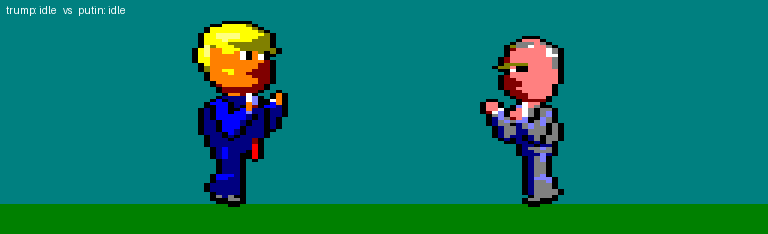

# Puppet Fight CPC

A one-on-one fighting game for the **Amstrad CPC 6128**, written in Z80
assembly. World leaders and celebrities, as felt caricature puppets inspired
by GZERO Media's satire series *Puppet Regime*, fight with large pre-rendered
sprites in Mode 0 overscan. Two fighters load from disk per match. The first
bout is **Trump vs Putin**.



> Status: **pre-alpha**. The art pipeline and the first two fighters are
> done. The engine hasn't been started. See the [game plan](docs/GAME_PLAN.md)
> for milestones.

## Features (planned)

- Big puppet sprites: 32×64 Mode 0 pixels per frame, 64×64 for falls and
  knockdowns, in a full overscan display
- 14 moves per fighter: idle, walk, crouch, jump, punch, kick, sweep,
  uppercut, back kick, block, hit, KO, special and victory, each at least
  3 frames
- Character-specific specials from each puppet's on-show persona, e.g.
  Trump's **Tweet Storm** and Putin's **Judo Throw**
- 1P vs CPU, 2P versus, and an arcade ladder with a secret boss
- Characters stored as separate disk files, so the roster can keep growing

## Fighters

| Fighter | Billing | Status |
|---|---|---|
| Donald Trump | "The Greatest American 2.0" | ✅ sprites done |
| Vladimir Putin | "Meddler-in-Chief" | ✅ sprites done |
| Kim Jong-Un | "The Supremest Leader" | 🎯 next wave |
| Xi Jinping | "President Emperor of the PRC" | 🎯 next wave |
| Elon Musk | "Tech Support" | 🎯 next wave |
| Volodymyr Zelensky | "Humble President of Ukraine" | 🎯 next wave |
| Modi, MBS, Biden, Macron, Merkel, Bolsonaro, Lula, Zuckerberg, Ian Bremmer (boss) | | 📋 later |

Full profiles, special-move ideas and palette notes: [docs/CHARACTERS.md](docs/CHARACTERS.md).

## Repository layout

```
art/blender/      puppets.blend: puppet scenes (PF_trump, PF_putin), poses keyframed
art/render/       Blender renders (material-ID + lit passes per frame)
art/sprites/      quantised sprite PNGs, sheets, previews, editable .aseprite files
data/sprites/     CPC data: masked Mode 0 frames (.asm/.bin), palette
docs/             game plan, character roster, pipeline notes, preview GIFs
tools/            pipeline scripts (Blender, Python, Aseprite Lua)
```

## Rebuilding the sprites

Requirements: Blender 5.2 and Aseprite 1.3 (both used through MCP in this
project), Python 3 with Pillow.

1. **Render** in Blender. This builds the puppets and renders every frame:
   ```python
   REPO = r"\\wsl.localhost\Ubuntu\home\vasilhs\repos\PuppetFightCPC"
   g = dict(globals(), REPO=REPO, CHARACTERS=["trump", "putin"], RENDER=True)
   exec(open(REPO + r"\tools\blender_puppets.py").read(), g)
   ```
2. **Quantise** to Mode 0 sprites:
   ```bash
   python3 tools/make_sprites.py
   ```
3. **Aseprite**: run `tools/aseprite_build.lua` to create the `.aseprite`
   files, edit them, then run `tools/aseprite_export.lua` to write the frames
   back out.
4. **Export** the CPC data:
   ```bash
   python3 tools/cpc_export.py
   ```
5. **Preview** GIFs:
   ```bash
   python3 tools/preview_gif.py
   ```

Details (sprite spec, palette, quantisation, memory figures):
[docs/PIPELINE.md](docs/PIPELINE.md).

## Documentation

- [Game plan](docs/GAME_PLAN.md): gameplay, controls, combat model, screen
  and memory design, character file format, toolchain, milestones, risks
- [Character roster](docs/CHARACTERS.md): researched *Puppet Regime* cast with
  personas, specials and palette notes
- [Art pipeline](docs/PIPELINE.md): Blender → Aseprite → CPC data

## Credits and disclaimer

A non-commercial fan project. The characters are caricatures inspired by
[*Puppet Regime*](https://gzeromedia.com/puppet-regime/) by GZERO Media
(Eurasia Group). This project is not affiliated with or endorsed by GZERO
Media, Eurasia Group, or any person depicted. All characters are satirical.
