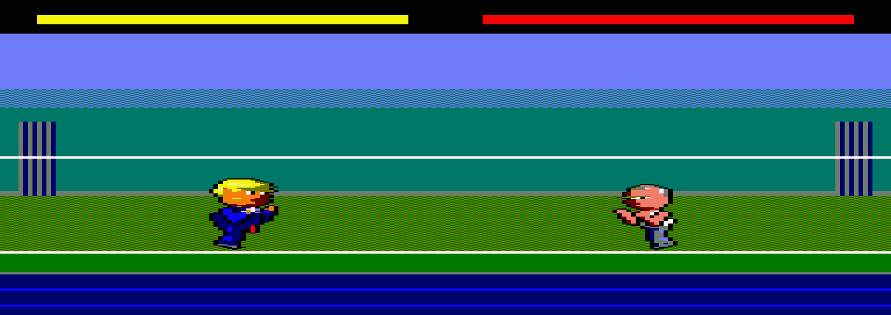

# Milestone 1 — Tech Spike Results

Can two big puppet fighters be drawn on a full overscan Mode 0 screen at
25 fps with no flicker? Yes, in every case tested. That includes the worst
one: both fighters in the air and overlapping, which share one window. The
first pass worked when the fighters were apart but had almost no margin
when they overlapped. The follow-up (banded rebuild + restore lists, below)
covers overlaps and jumps with 2-3 ms to spare. The decisions are in
[GAME_PLAN.md §3](GAME_PLAN.md#3-technical-design).



*Trump (compiled, facing right) and Putin (mirrored, facing left) idling and
swaying on a 192×272 overscan stage, captured from the emulated 6128.*

## What was built

| File | What it does |
|---|---|
| `src/main.asm` | boot and move down to &0200, 25 fps loop, two-window schedule, spike logic (idle animation, sway, jumps) |
| `src/rebuild.asm` | the banded scheduler: restore and draw jobs for both fighters, run band by band ahead of the beam; job set-up |
| `src/crtc.asm`, `src/irq.asm`, `src/video.asm` | overscan CRTC set-up, VSYNC-recognised frame tick, line table, stage, background mirror |
| `src/sprite.asm` | restore from a prepared restore list, the list builder, and the generic mirrored span drawer |
| `tools/sprite_codegen.py` | span streams, (s, n) tables, compiled routines with a yield every 8 lines (both facings), flip/mask tables |
| `tools/spike_bench.py` | runs the snapshot on the headless 6128 and measures it |

```bash
make                                    # build/pfspike.sna and build/pfspike.dsk (RUN"PFSPIKE)
make bench                              # measure on the headless 6128
make run                                # open in Caprice32
make bench-all                          # the three scenarios the 25 fps rule must hold in
make PUTIN_DRAW=compiled CLOSE_UP=1 JUMP=1   # variants, see the Makefile
make bench ... SLACK=20                 # margin test: start every rebuild 2 ms late
```

## How it was measured

`tools/spike_bench.py` drives floooh/chips' CPC 6128 (cycle-accurate Z80,
gate array and CRTC, real ROMs) through `~/repos/CPCTools/cpcemu`, 16 µs at
a time:

- **Phase timing.** The rebuild writes `bench_phase` at every step, so the
  time each value is held is the cost of that step.
- **Beam check.** As the beam starts each scanline of the fighter band, the
  bytes it is about to fetch are captured. Every frame is judged: if the
  bytes match neither the band at the frame's start nor at its end, that
  line was *caught* half drawn, which is visible flicker. Matching the start
  only is *late*: the line shows the previous picture for one frame.
- **Correctness.** The band is rebuilt in Python from the background mirror
  and the span streams in RAM, then compared with the screen byte for byte.
  Any difference is debris or a drawing bug.

## First pass results (60 pictures each)

| Step | Trump (352 bytes, 62 lines) | Putin (275 bytes, 57 lines) |
|---|---|---|
| Restore from mirror | 5.40 ms | 5.13 ms |
| Compiled draw | 2.83 ms (right) | 2.36 ms (left) |
| Generic mirrored span draw | — | 8.71 ms |

The beam reaches the standing fighters' top line (204) 15.6 ms after the
frame tick.

| Scenario | Rebuild ends | Lines caught | Bytes wrong |
|---|---|---|---|
| Apart, generic Putin | 13.9 ms | 0 | 0 |
| Apart, compiled Putin | 8.4 ms | 0 | 0 |
| Overlapping, generic Putin | 22.2 ms | **33** (lines 234-266) | 0 |
| Overlapping, compiled Putin | 15.8 ms | 0 (no margin) | 0 |

Before the two-window schedule, both fighters were rebuilt after every
other tick: 22 ms, and Putin's lower half was caught every picture.

## Findings

1. **Single buffer + background mirror works.** There are no save buffers
   and no debris, and overlapping fighters restore correctly in any order.
   The mirror costs 12K of the &4000-&7FFF page.
2. **Each fighter gets its own frame.** At 25 fps there are two 15.6 ms
   windows per picture. Rebuilding one fighter in each is what made the
   generic drawer flicker-free.
3. **Per-line overhead dominates.** Restore spends ~53 µs per line before
   copying a byte, and the generic drawer ~56 µs. Compiled code spends
   ~12 µs per line.
4. **Compiled is 3.7× faster but 3.4× bigger** than the span data (~1.5 KB
   against ~450 bytes per frame). Every frame in both facings would be
   ~150 KB per character.
5. **The overlap case is the limit.** Both fighters in one window need
   compiled draws *and* a cheaper restore. A fighter jumping while they
   overlap (top at line 144, deadline 11.8 ms) doesn't fit yet.

## Gotchas found

- rasm's default v3 snapshot is packed, and `cpcemu` segfaults on it. The
  Makefile passes `-v2`.
- Inside the rebuild, SP walks `line_tab`. A single `push` there (even
  `push hl : pop iy`) overwrites a scanline address, and the next picture
  then writes to the wrong place. Steps chain through IY and never push.

- rasm divides in floating point and rounds, so `label/256` is the high
  byte only for page-aligned labels: &04F6/256 assembled as 5. Use
  `label>>8`.
- rasm doesn't export `-D` defines to the symbol file, even with `-sq`.
  `config.asm` copies the scenario switches into `SCN_*` EQUs for the bench.

## Follow-up: 25 fps in every case (banded rebuild)

25 fps is a hard rule ([GAME_PLAN §3.2b](GAME_PLAN.md#32b-frame-rate-locked-at-25-fps)),
so the overlap case had to fit with room to spare, jumps included.

**Banded rebuild** (`src/rebuild.asm`). The four steps of a shared window
(restore A, restore B, draw A, draw B) are jobs. The scheduler walks the
screen in 16-line bands, top to bottom, and runs every job as far as its
target in that band. Restores can stop on any line. Compiled draws yield
every 8 lines (the generator puts a `DEC IXL : JR NZ` checkpoint there). To
keep the per-line order, the targets are staggered: restores to
band + 16, draw A to band + 8, draw B to band + 0. Whatever line a job
touches has already been finished by every job that must come before it.
Lines are kept relative to the band's top line so all the bookkeeping is 8-bit.

**Restore lists.** The restore was twice the cost of a compiled draw, nearly
all of it per-line set-up (~53 µs). Now `prepare`, which runs in idle logic
time after each picture, turns each fighter's on-screen frame into a list
of (screen address, byte count) per scanline. Inside the window the
restore is `POP DE : POP BC`, mirror address, `LDIR`: ~17 µs per line. The
lists sit in unused tails of screen page 3 (&CCE0, &D4E0), next to
`line_tab` (&C4E0), so they cost no payload.

**Prepared jobs.** Job set-up also moved into `prepare`, so the rebuild
starts 32-80 µs after the tick instead of 300-700.

### Results (96 pictures, every frame judged)

| Step | First pass | Now |
|---|---|---|
| Restore Trump | 5.40 ms | 3.33 ms |
| Restore Putin | 5.13 ms | 2.78 ms |
| Compiled draw Trump / Putin | 2.83 / 2.36 ms | 2.93 / 2.44 ms (+8-line yields) |
| Scheduler overhead | — | ~1.3 ms per picture |

| Scenario | Latest window end | Lines caught | Lines late | Bytes wrong |
|---|---|---|---|---|
| Apart (two windows), generic Putin | 12.3 ms | 0 | 0 | 0 |
| Toe to toe (shared window), compiled | 12.6 ms | 0 | 0 | 0 |
| Toe to toe + jumps, compiled: Trump up | 13.1 ms | 0 | 0 | 0 |
| ... Putin up | 13.2 ms | 0 | 0 | 0 |
| ... **both up** (tops at line 144) | 12.8 ms | 0 | 0 | 0 |

**Margin.** `SLACK=n` starts every rebuild n×100 µs late. In the worst case
(both in the air, overlapping): 2.0 ms late is still clean, 3.0 ms late
catches 13 lines. Before the restore lists and prepared jobs, 0.5 ms late
already caught 29.

Banding alone wasn't enough. With the old restore, the both-up case caught
56 lines: everything sits in lines 144-207, which the beam has finished by
15.8 ms, and the work was ~17.5 ms. The cheaper restore is what made it fit.
Banding's job is ordering: every line is finished in top-to-bottom order,
whichever fighter is higher. The old fixed order (all restores, then all
draws) wasn't benchmarked with jumps, so this run doesn't show how much
margin banding adds on its own.

## Follow-up: raised floor

Every stage now keeps the bottom 60 lines as a raised floor, because RVM
cuts off the bottom of the overscan picture. The fighters moved 56 lines
up (feet on line 212, band 88-211), so the beam reaches them 3.6 ms sooner
after VSYNC. That would have eaten the whole margin.

Instead the rebuild now starts on the interrupt at line 222, the fifth
after VSYNC, just after the beam leaves the fighters. The head start to
their tops is 0.4 ms shorter than before (15.2 ms standing, 11.4 ms at the
top of a jump). Because the window now crosses VSYNC, the scheduler lets
interrupts in after every job and the generic drawer every 8 lines. No
stretch with them off is over ~1.3 ms, so the Gate Array keeps the
interrupt count exact.

The bench now keeps exact emulator time from boot. It fixes VSYNC from the
first tick after `irq_init`, finds the beam by arithmetic (the frame is
always 19968 µs), and judges each beam pass against the band at the start
of its rebuild and at the start of the next.

| Scenario | Rebuild ends with the beam on line | Lines caught | Late | Bytes wrong |
|---|---|---|---|---|
| Apart, generic Putin | 121 | 0 | 0 | 0 |
| Toe to toe, compiled | 120 | 0 | 0 | 0 |
| Toe to toe + jumps, worst state | 130 | 0 | 0 | 0 |

Margin in the both-jumping case: clean at `SLACK=15` (1.5 ms late), 26
lines caught at `SLACK=20`. That's 0.5 ms less than before the floor moved.

## Milestone 2 step 1: characters in the banks

Every frame of both characters (48 each, all 14 moves) now lives in the
extra 64K. Trump is in banks 4-5 and Putin in 6-7, each found through a
directory at &4000 of its first bank (GAME_PLAN §3.4). The engine payload
dropped from &38D5 to &10BE.

- **Fighter records.** Each fighter is an `F_*` record: position, facing,
  move and frame. `load_frame` fills in what the directory says about that
  frame, and the `F_O*` fields hold what is on the screen. The same
  `setup_fighter` serves both fighters.
- **Generic drawers for both facings** (`draw_r`, `draw_l`). They work in
  8-line chunks like the compiled draws, because span streams are now
  padded to whole chunks. They take their column in A from the job record,
  so either fighter can face either way.
- **Paging per job.** Each draw job carries the RAM configuration it runs
  in. Restores always run with #C0 (the mirror), with a constant `OUT`
  and no other loads. That's what won back the margin the paging had cost.
- **Disc.** Each bank is a file, and `PFSPIKE.BAS` pages it in and loads it.
  ASCII BASIC on a CPC disc needs CR LF line endings (`.gitattributes`
  keeps them).

Bench (every scanline pass judged, sprites read back from the banks):
0 lines caught, 0 late, 0 wrong bytes in all three scenarios, and
`SLACK=15` still clean in the both-jumping case.

## Milestone 2 step 2: two players and the fighter state machine

`DEMO=0`, the default now, is the game. `DEMO=1` keeps the scripted sway
and jumps that `bench-all` measures.

- **Input** (`src/input.asm`). Scans the keyboard matrix through the PSG
  each picture (~0.1 ms) and maps it to a control byte per player:
  joystick 0, or the cursor keys with Space and Copy, for player 1;
  joystick 1, or W A S D with Z and X, for player 2.
- **State machine** (`src/fighter.asm`). The move is the state. Idle, walk
  and crouch are free: the controls choose the next move. Attacks play once
  and go back to idle (a sweep stays crouched while ↓ is held). A jump is a
  16-picture arc that can carry the fighter across, even over the opponent.
  Free fighters turn to face each other. Walls stop them, a walk stops
  10 bytes from a standing opponent, and `separate` pushes apart two that
  a landing left inside each other. Frames advance every 2 pictures.
- **Scripted play bench.** `make bench-play` presses keys on a script
  (`--keys RIGHT@2-26,x@40,...`, by picture number) and saves screenshots
  (`--shots`). The run walks Trump and Putin together, then has them punch,
  kick, crouch, sweep and uppercut, jump over each other and turn round.
- **Frames per picture.** The bench now also reports the frames between
  pictures. That exposed a frame drop the line check couldn't see: with
  the fighters apart, the set-up after a window took longer than the time
  left before the next tick (~3.5 ms per fighter against ~5.5 ms). Two
  changes fixed it. `build_restore` was rewritten (SP walks `line_tab` 16
  lines per interrupt-off stretch, one loop per facing, x patched into the
  code): ~2.8 ms. And `prebuild` runs it in the time between windows, into
  a second list per fighter: A's after the first window, B's after the
  second, before the logic. The set-up after the logic costs 0.6-1.1 ms.
  The keys are tested with straight-line code instead of a table loop
  (logic 2.1 → 1.3 ms).

| Scenario | Frames between pictures | Lines caught | Bytes wrong |
|---|---|---|---|
| Apart, generic Putin | 2 every time | 0 | 0 |
| Toe to toe, compiled | 2 every time | 0 | 0 |
| Toe to toe + jumps, compiled | 2 every time | 0 | 0 |
| Play script (close combat, generic draws) | 2, except one picture: 3 | 57 lines in 1,559 line passes | 0 |

Margin in the both-jumping case: clean at `SLACK=14`, one line caught in
one picture at `SLACK=15`. The committed engine dropped two frames at
`SLACK=15`, which hid it.

Close combat in the game still flickers. Only the idle frames have
compiled draws, and two generic draws (~8.5 + 7.5 ms) don't fit a shared
window. That's the runtime compiler's job.

## Milestone 2 step 3: runtime compiler (in progress)

Every frame is now drawn by compiled code, compiled at run time
(`src/jit.asm`). With both fighters compiled, a single window always fits,
so the two-window "apart" mode, the generic drawers and the precompiled
idle frames are gone.

- **Compiler.** Reads the span stream and writes, per line,
  `pop hl : add hl,de : ld bc,col : add hl,bc`, then one store per byte, with
  a yield every 8 lines. Facing left, the line starts at column w − 1 − s and
  steps left (`dec hl`), with each byte through `flip_tab`, so both facings
  read the bytes in the same order. Span streams are escaped: an opaque byte
  is itself, and a hole or a byte with a pen 0 pixel is 0 then the byte, so
  the common case costs one test. The compiler also writes each frame's
  (s, n) table for `build_restore`, so the banks no longer carry them.
- **Cache.** Trump has 4 slots in main RAM and Putin 2 (1,872 bytes each,
  &1420-&3FFF). On top of those, each character has the slots its directory
  puts at the top of bank 1: 3 for Trump, 5 for Putin. A bank slot only
  takes frames whose spans are in bank 1, because the compiler reads and
  writes with that one bank paged in. So `sprite_codegen.py` puts the moves
  a fight shows most (idle, walk, crouch, jump, punch, and kick for Trump)
  in bank 1, and as many slots as fit above them. The idle and walk loops
  (4 frames each) now stay cached. Slot tables sit at &C700, the (s, n)
  tables in the tails of screen slices 2, 5 and 7, and `flip_tab` /
  `mask_tab` are built at boot in slice 1's tail. That frees 512 bytes of
  payload, enough for Trump's fourth main slot.
- **Scheduling.** `load_frame` takes the logic's frame from the cache. On a
  miss the fighter keeps the frame it shows, and the frame is marked as
  wanted. After `prepare`, `jit_work` compiles wanted frames first, then
  each fighter's likely next frame. Before every line, the compiler checks
  whether it has reached the last interrupt period before the tick. If so,
  it stops and carries on in the next picture, so a picture is never late.
- **Restore lists are kept** when a fighter shows the same frame in the
  same place: 5.4 → 3.2 ms per picture in play.

| Scenario | Frames between pictures | Lines caught | Pictures with a held frame (Trump / Putin, of 96) |
|---|---|---|---|
| Apart | 2 every time | 0 | 0 / 0 |
| Toe to toe | 2 every time | 0 | 0 / 0 |
| Toe to toe + jumps | 2 every time | 0 | 0 / 0 |
| Play script (close combat) | 2 every time | 0 | 52 / 23 |

Margin: `SLACK=15` is clean again in the both-jumping case.

**What's left.** In the play script the compiler is busy almost all the
time. It changes move every few pictures, and every new move or turn needs
3-4 frames at 13-17 ms each, about one frame per picture. Fighters hold a
frame while they wait, mostly at the start of a move and after a turn.

A `PUSH` compiler doesn't help. An opaque byte's code is 3 bytes
(`36 b 23`), so pushes need extra register loads or an `inc sp`: about
23 µs per byte against 24 now. `LDI`/`LDIR` drawing from the span data
would make compiling cheap, but on the CPC `LDIR` costs 6 µs a byte
against 5 for `ld (hl),n : inc hl`. Facing left also needs flipped data.

### Improvements

- **The draw walks the new frame's restore list.** A restore list already
  holds, per line, the screen address of the frame's leftmost byte and its
  byte count. It is now built in `prepare` for the frame about to be drawn,
  not after the window for the one just drawn. The draw job's SP walks it,
  and the next picture restores from the same list. A compiled line starts
  `pop hl : pop af` facing right, or `pop hl : pop bc : add hl,bc` facing
  left, where each byte is then `dec hl` and its store. Before, a line
  started `pop hl : add hl,de : ld bc,col : add hl,bc`. The largest frame
  shrank from 1,871 to 1,740 bytes, so slots are now 1,744 bytes and Putin
  gets a sixth bank slot. Draws are ~0.35 ms faster per fighter, and the
  separate restore-list step after the window is gone.
- **Fighters that don't change are left alone.** If a fighter shows the
  same frame in the same place and the other fighter's old and new boxes
  don't reach it, neither its restore nor its draw runs.

| Play script | Before | Now |
|---|---|---|
| Compile per frame | 17.4 ms | 16.0 ms |
| Frames compiled | 80 | 67 |
| Pictures with a held frame (Trump / Putin) | 52 / 23 | 32 / 30 |
| Latest window end, fighters standing (DEMO) | line 124 | line 116 |

The DEMO scenarios still show 2 frames between every pair of pictures,
0 lines caught and no held frames. `SLACK=15` is clean, and at `SLACK=20`
2 lines are caught (it was 26 before the raised floor).

What's left in the compiler is the byte loop itself: ~24 µs per opaque
byte facing right and ~29 facing left (read, test, two stores and a step,
count). The remaining tweaks (`exx` for the (s, n) pointer, the mask
worked out instead of looked up) are worth ~5%.

## Next (milestone 2 work this feeds)

- Held frames in busy play: the compiler does about one frame per picture,
  and a new move or a turn needs 3-4. Options: let the logic start a move
  on a frame that is already cached, or compile a move's first frame ahead
  when its input is likely (an attack button held, the opponent close).
- Confirm on real hardware (CRTC types 0-2), as OverscanCPC did.