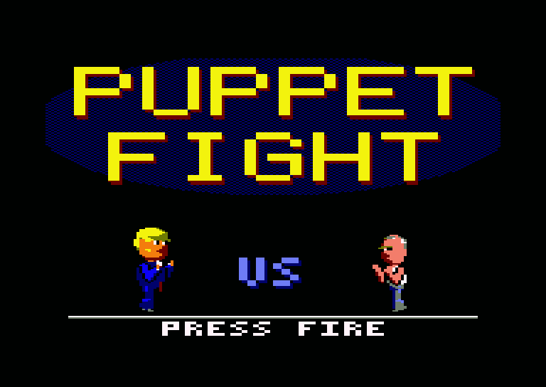
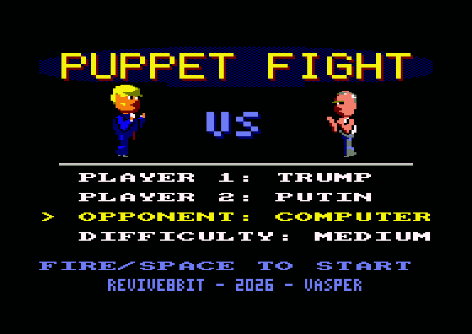
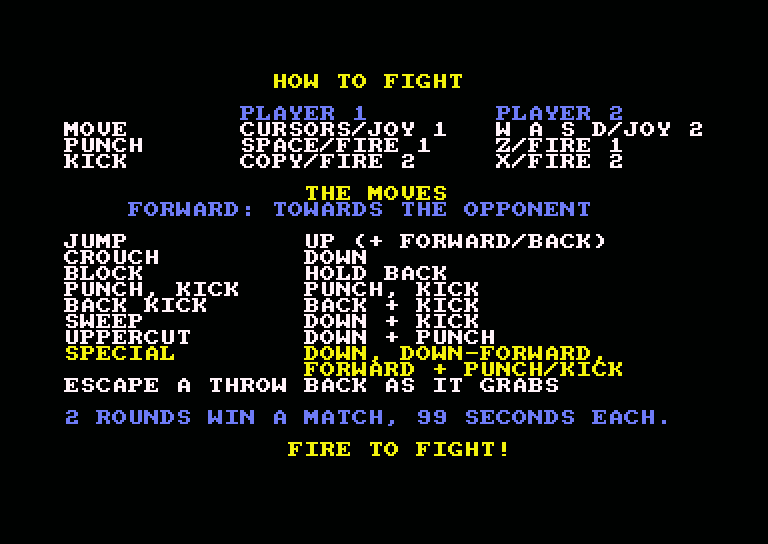
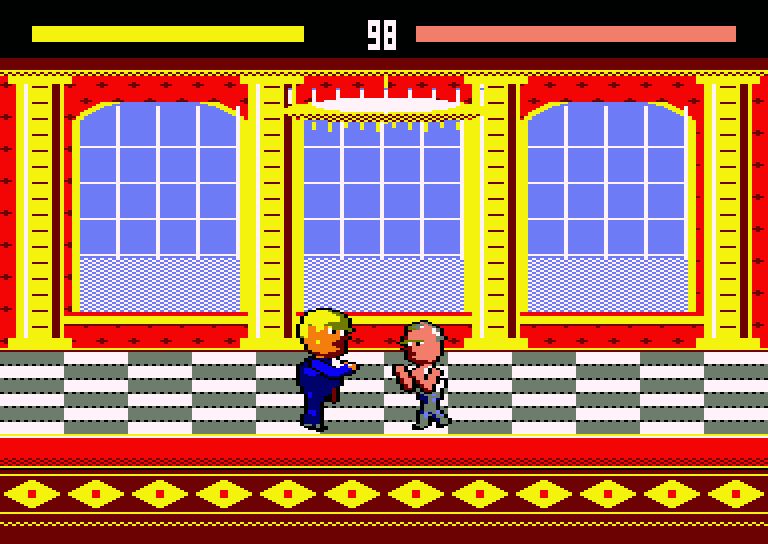
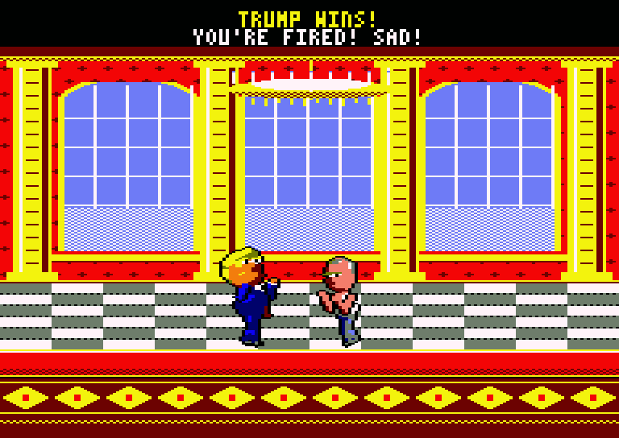
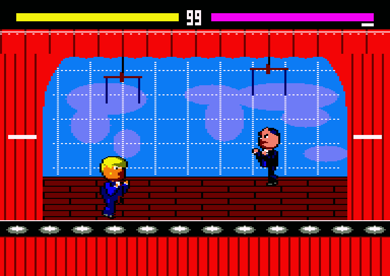
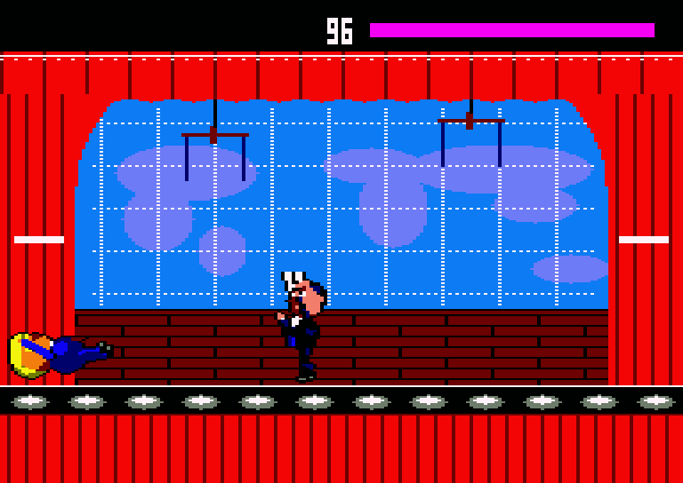

# Puppet Fight — Εγχειρίδιο

*Amstrad CPC 6128 (128K, δισκέτα). REVIVE8BIT – 2026 – VASPER.*

## Η ιστορία

### Η σύνοδος που δεν ζήτησε κανείς

Θα ήταν σύνοδος κορυφής για την ειρήνη. Είχε σημαίες, είχε στρογγυλό
τραπέζι, και είχε μπουφέ που κόστιζε περισσότερο από ένα μικρό κράτος.

Ώσπου κάποιος άγγιξε το τελευταίο κρουασάν.

Μέσα σε ενενήντα εννέα δευτερόλεπτα το στρογγυλό τραπέζι είχε γίνει
κομμάτια και οι διερμηνείς είχαν τρέξει στις εξόδους. Οι πιο ισχυροί ηγέτες
του κόσμου σήκωναν τα τσόχινα μανίκια τους. Η διπλωματία απέτυχε, οπότε
γύρισε ο παλιός τρόπος: δύο κούκλες, μία σκηνή, καμία ερώτηση από τον Τύπο.

Οι μονομάχοι:

- **Donald Trump, The Greatest American 2.0.** Ήρθε να κάνει τη σύνοδο
  ξανά μεγάλη και έφυγε αφού απέλυσε τρία τραπέζια. Το Tweet Storm του
  στέλνει ένα έξαλλο πουλάκι στη σκηνή, με ΚΕΦΑΛΑΙΑ. *«Κανείς δεν ρίχνει
  γροθιές καλύτερα από μένα. Όλοι το λένε.»*
- **Vladimir Putin, Tsar of All the Puppets.** Έβγαλε το πουκάμισο πριν
  περάσει την πόρτα. Μαύρη ζώνη στο τζούντο, και στο ξαναγράψιμο των
  κανόνων του τζούντο. *«Δεν σε έριξα. Έπεσες στα χέρια μου. Είναι
  διαφορετικό.»*
- **Kim Jong-Un, Supremest Leader.** Τον κάλεσαν κατά λάθος και ήρθε με
  σανίδα του σερφ, πάνω σε έναν πύραυλο. Η κρατική τηλεόραση τον έχει ήδη
  ανακηρύξει νικητή σε κάθε γύρο, και σε αυτούς που δεν έχουν παιχτεί
  ακόμα.
- **Xi Jinping, President Emperor.** Έφερε μια ζώνη και έναν δρόμο, και τα
  χρησιμοποιεί και τα δύο για να σε φτάσει από την άλλη άκρη της σκηνής.
  Αργά ή γρήγορα, όλα γίνονται κομμάτι του Belt and Road.
- **Elon Musk, Tech Support.** Αγόρασε την αρένα στη μέση του πρώτου γύρου
  και τη μετονόμασε σε «X Stage». Το αλυσοπρίονο ήταν «μόνο για περικοπές».
  Το στυλ μάχης του είναι ακόμα σε beta.
- **Volodymyr Zelensky, Humble President.** Δεν ήρθε για καβγά, ήρθε για
  εφόδια, και ζητάει όλο και περισσότερα κιβώτια. Τα κιβώτια είναι βαριά
  και αργά, και πονάνε.

Νίκησε και τους έξι. Τότε τα φώτα χαμηλώνουν, η κουρτίνα σαλεύει και
κάποιος γελάει πνιχτά πίσω από τη σκηνή. Όλη αυτή την ώρα πάλευες με
κούκλες. Τώρα γνώρισε το χέρι μέσα τους.

**Ian Bremmer, The Puppet Master.** Έχει αναλύσει κάθε σου κίνηση και την
έχει κάνει έκθεση γεωπολιτικού ρίσκου σαράντα σελίδων. Το G-Zero World του
είναι η ίδια η υδρόγειος, που την πετάει πάνω σου επειδή δεν την κουμαντάρει
κανείς άλλος.

Δύο γύροι κερδίζουν τον αγώνα, 99 δευτερόλεπτα ο καθένας, καμία
διπλωματική ασυλία.

*Κανένας αληθινός ηγέτης δεν τραυματίστηκε. Αρκετές κούκλες θέλουν
καινούργιο γέμισμα.*

## Φόρτωμα

Βάλε τη δισκέτα στο drive A και γράψε

    RUN"PUPPET

Πρώτα έρχεται η οθόνη του REVIVE8BIT· το **SPACE** την προσπερνά, αλλιώς
φεύγει μόνη της σε δέκα δευτερόλεπτα. Η οθόνη τίτλου εμφανίζεται όσο διαβάζονται οι μαχητές από τη δισκέτα.
Πάτα **fire** (ή **SPACE**) για να πας στην οθόνη επιλογής.

Το παιχνίδι θέλει CPC 6128 (ή 464/664 με 128K και drive δισκέτας). Άφησε
τη δισκέτα στο drive: όταν παίζεις με τον υπολογιστή, ο επόμενος αντίπαλος
φορτώνει από αυτήν ανάμεσα στους αγώνες. Το παιχνίδι διαβάζει τη δισκέτα
απευθείας, οπότε θέλει πραγματικό drive ή εξομοιωτή δισκέτας όπως Gotek ή
HxC. Οι κάρτες M4 δεν μπορούν να φορτώσουν τον επόμενο αντίπαλο.

## Η οθόνη επιλογής

Το μενού έχει μια γραμμή για κάθε επιλογή, και από πάνω στέκονται οι δύο
μαχητές.

| Γραμμή | Επιλογές |
|---|---|
| Player 1 | όποιος μαχητής θέλεις |
| Player 2 | όποιος μαχητής θέλεις (και ο ίδιος: ο δεύτερος παίρνει άλλα χρώματα) |
| Opponent | Human (άνθρωπος), Computer (υπολογιστής) ή Training (προπόνηση) |
| Difficulty | Easy, Medium ή Hard (μόνο όταν αντίπαλος είναι ο υπολογιστής) |
| Dummy | Stand, Crouch, Jump ή Block (μόνο στην προπόνηση) |

Τα πλήκτρα:

| Πλήκτρο | |
|---|---|
| **Πάνω** / **Κάτω** | Διαλέγεις γραμμή (το βελάκι και το κίτρινο δείχνουν ποια) |
| **Αριστερά** / **Δεξιά** | Την αλλάζεις |
| **Fire** / **SPACE** | Ξεκινάς |

Το μενού το χειρίζονται τα πλήκτρα και των δύο παικτών. Όταν αντίπαλος
είναι ο υπολογιστής, παίζει με τον μαχητή του Player 2.

## Πώς παλεύεις

Μετά το μενού, μια οθόνη δείχνει τους χειρισμούς και τις κινήσεις όσο οι
μαχητές φορτώνουν από τη δισκέτα. Όταν γράψει **FIRE TO FIGHT!**, πάτα
fire για να ξεκινήσεις.

## Χειρισμοί

| | Παίκτης 1 | Παίκτης 2 |
|---|---|---|
| Κίνηση | Βελάκια ή joystick 1 | W A S D ή joystick 2 |
| Γροθιά | SPACE ή fire 1 | Z ή fire 1 |
| Κλοτσιά | COPY ή fire 2 | X ή fire 2 |

Στις κινήσεις, **μπροστά** σημαίνει προς τον αντίπαλο και **πίσω** μακριά
του. Οι μαχητές γυρίζουν πάντα ο ένας προς τον άλλο.

## Κινήσεις

| Κίνηση | Πώς | |
|---|---|---|
| Περπάτημα | Αριστερά / δεξιά | |
| Άλμα | Πάνω (πάνω και μπροστά ή πίσω για άλμα προς τα εκεί) | Μπορείς να πηδήξεις πάνω από τον αντίπαλο |
| Σκύψιμο | Κάτω | |
| Άμυνα | Κράτα πίσω όσο ο αντίπαλος επιτίθεται | Σταματά γροθιές, κλοτσιές και βλήματα |
| Γροθιά | Γροθιά | 4 ζημιά |
| Κλοτσιά | Κλοτσιά | 5 ζημιά |
| Πισινή κλοτσιά | Πίσω + κλοτσιά | 6 ζημιά |
| Σκούπα | Κάτω + κλοτσιά | 4 ζημιά, ρίχνει κάτω |
| Ανάποδη γροθιά | Κάτω + γροθιά (ή κάτω, μετά πάνω + γροθιά) | 6 ζημιά, ρίχνει κάτω. Καλή ενάντια σε άλματα |
| Ειδική κίνηση | Κάτω, κάτω-μπροστά, μπροστά + γροθιά ή κλοτσιά | Του καθενός η δική του (δες πιο κάτω) |

Όποιο χτύπημα πετύχει μαχητή στον αέρα τον ρίχνει κάτω. Ένας μαχητής που
έπεσε σηκώνεται ξανά σε λίγο.

## Ειδικές κινήσεις

Υπάρχουν τριών ειδών:

- Τα **βλήματα** διασχίζουν τη σκηνή. Μπλοκάρονται, αλλά ένα μπλοκαρισμένο
  βλήμα παίρνει και πάλι έναν πόντο ζωής (ποτέ τον τελευταίο). Δύο βλήματα
  που συναντιούνται εξαφανίζονται. Πάνω από έναν μαχητή πεσμένο στο
  έδαφος περνούν χωρίς να τον χτυπήσουν. Κάθε μαχητής έχει ένα βλήμα στον
  αέρα τη φορά.
- Τα **χτυπήματα** πιάνουν σαν μεγάλη επίθεση: 10 ζημιά, και ρίχνουν κάτω.
- Οι **λαβές** αρπάζουν έναν αντίπαλο που στέκεται κοντά και τον πετούν
  στην άλλη πλευρά: 10 ζημιά, και πέφτει κάτω. Η λαβή δεν μπλοκάρεται. Για
  να ξεφύγεις, πάτα πίσω ακριβώς τη στιγμή που σε πιάνει. Αν το κρατάς ήδη
  πατημένο, είναι αργά.

## Γύροι και αγώνες

Κάθε μαχητής έχει μια μπάρα ζωής στην κορυφή της οθόνης, με το όνομά του
από πάνω, ο παίκτης 1 αριστερά, και ανάμεσά τους είναι το ρολόι του
γύρου. Κάθε χτύπημα που πετυχαίνει πετάει ένα συννεφάκι σαν των κόμικς
πάνω από αυτόν που το δέχτηκε: POW!, BAM!, ZAP!, WHAM και τα υπόλοιπα. Ο γύρος τελειώνει με
νοκ άουτ ή όταν το ρολόι φτάσει στο τέλος, μετά από 99 δευτερόλεπτα. Τότε
κερδίζει όποιος έχει περισσότερη ζωή· με ίδια ζωή, δεν κερδίζει κανείς. Ο
νικητής του γύρου παίρνει ένα σημάδι κάτω από την μπάρα του. Δύο γύροι
κερδίζουν τον αγώνα.

Μεγάλα γράμματα στη μέση της οθόνης ανοίγουν κάθε γύρο, **BEGIN FIGHT**,
και τον κλείνουν: **K.O.**, **PERFECT** (νοκ άουτ χωρίς να χάσεις καθόλου
ζωή), **TIME UP** ή **DRAW** (ισοπαλία). Κρύβονται όσο ένας μαχητής
πηδάει μέσα από αυτά.

Το **ESC** σταματά τον αγώνα και ρωτάει πάνω από τα ονόματα **EXIT ?
ESC=YES, FIRE1=NO**. Ένα δεύτερο **ESC** σε γυρίζει στο μενού: το παιχνίδι
το φορτώνει ξανά από τη δισκέτα, οπότε άφησέ την στον οδηγό. Το **fire**
(ή το **SPACE**) συνεχίζει τον αγώνα από εκεί που σταμάτησε.

## Εναντίον του υπολογιστή: η σκάλα

Βάλε **Opponent** σε **Computer** στην οθόνη επιλογής για να παίξεις με
τον υπολογιστή. Κάθε φορά που κερδίζεις έναν αγώνα, η οθόνη σκοτεινιάζει
για λίγα δευτερόλεπτα όσο ο επόμενος αντίπαλος και το δικό του σκηνικό
έρχονται από τη δισκέτα. Επόμενος αντίπαλος είναι ο επόμενος μαχητής της
λίστας, εκτός από τον δικό σου.

Νίκησε όλους τους άλλους και η αυλαία ανοίγει για τον **Puppet Master**,
που παλεύει πάντα στο δυσκολότερο επίπεδο. Νίκησέ τον και η σκάλα ξεκινά
από την αρχή. Αν χάσεις έναν αγώνα, ξαναπαλεύεις με τον ίδιο αντίπαλο.

Αν το περίγραμμα της οθόνης γίνει κόκκινο όσο φορτώνει ο επόμενος
αντίπαλος, η δισκέτα δεν διαβάστηκε. Το παιχνίδι συνεχίζει να προσπαθεί,
οπότε έλεγξε ότι η δισκέτα είναι στο drive A.

Με δύο παίκτες, κάθε αγώνα ακολουθεί ρεβάνς.

## Προπόνηση

Βάλε **Opponent** σε **Training** για να εξασκηθείς στις κινήσεις. Η
γραμμή του Player 2 δείχνει τότε το **Dummy**: ένα ανδρείκελο προπόνησης
από λινάτσα πάνω σε ελατήριο, με έναν στόχο στο στήθος. Λικνίζεται μπρος
πίσω, λυγίζει προς τα πίσω όταν το χτυπάς και ξαναπετάγεται όρθιο, και με
ένα ρίξιμο πέφτει ανάσκελα πάνω στη βάση του. Δεν αντεπιτίθεται ποτέ. Η
γραμμή **Dummy** διαλέγει τι κάνει:

| Dummy | |
|---|---|
| Stand | Στέκεται και τις τρώει |
| Crouch | Μένει σκυμμένο: το φτάνουν μόνο οι χαμηλές επιθέσεις |
| Jump | Χοροπηδάει συνέχεια: εξάσκηση στο uppercut |
| Block | Μπλοκάρει κάθε επίθεση και βλήμα, χαμηλά σε ένα sweep: εξάσκηση στη λαβή |

Το ρολόι μένει στο 99 και κανείς δεν κερδίζει γύρους: ένα νοκ άουτ απλώς
ξαναρχίζει τον γύρο, με γεμάτη ζωή. Το **ESC** δύο φορές σε γυρίζει στο
μενού, όπως σε κάθε αγώνα.

## Οι μαχητές

| Μαχητής | Τίτλος | Ειδική κίνηση | Σκηνικό |
|---|---|---|---|
| Donald Trump | The Greatest American 2.0 | Tweet Storm: ένα πουλάκι-tweet (βλήμα) | Ο Λευκός Οίκος |
| Vladimir Putin | Tsar of All the Puppets | Judo Throw (λαβή) | Το Κρεμλίνο |
| Kim Jong-Un | Supremest Leader | Surf's Up Missile (βλήμα) | Πιονγιάνγκ |
| Xi Jinping | President Emperor | Belt and Road: μια ζώνη με μακρύ βεληνεκές (χτύπημα) | Πεκίνο |
| Elon Musk | Tech Support | Chainsaw Rampage (χτύπημα) | Starbase |
| Volodymyr Zelensky | Humble President | More Ammo!: ένα κιβώτιο εφοδίων (βλήμα, αργό και βαρύ) | Κίεβο |
| Ian Bremmer | The Puppet Master | G-Zero World: μια υδρόγειος (βλήμα, το βαρύτερο) | Το κουκλοθέατρο |

Τον Puppet Master δεν τον διαλέγεις στην οθόνη επιλογής: τον αγώνα μαζί του
πρέπει να τον κερδίσεις.

## Σχετικά

Το Puppet Fight είναι μη εμπορικό fan project στο πνεύμα του *Puppet
Regime*, της σατιρικής εκπομπής με κούκλες του GZERO Media, που ενέπνευσε
τους ήρωές του. Μένει στο τρυφερό, παράλογο ύφος της εκπομπής: σαχλαμάρα
και καμία πραγματική βία.

Γραμμένο σε Z80 assembly για τον Amstrad CPC 6128. Ο αγώνας τρέχει
σταθερά στα 25 καρέ το δευτερόλεπτο σε πλήρη overscan οθόνη (192 × 272
pixels Mode 0). Οι κούκλες φτιάχτηκαν και στήθηκαν στο Blender, έγιναν
sprites Mode 0 και μεταγλωττίζονται σε κώδικα Z80 την ώρα που παίζεις.
